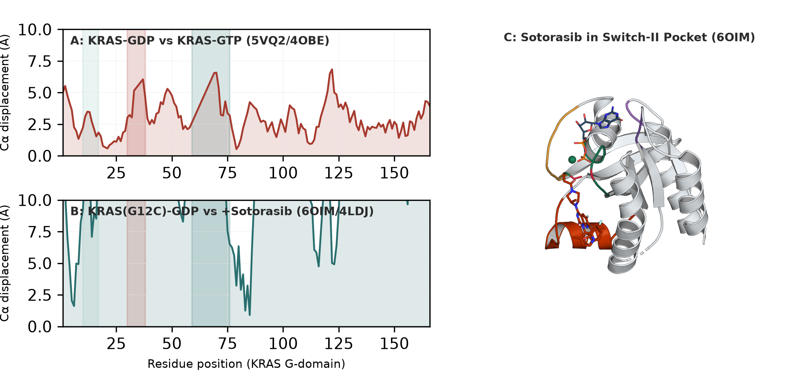
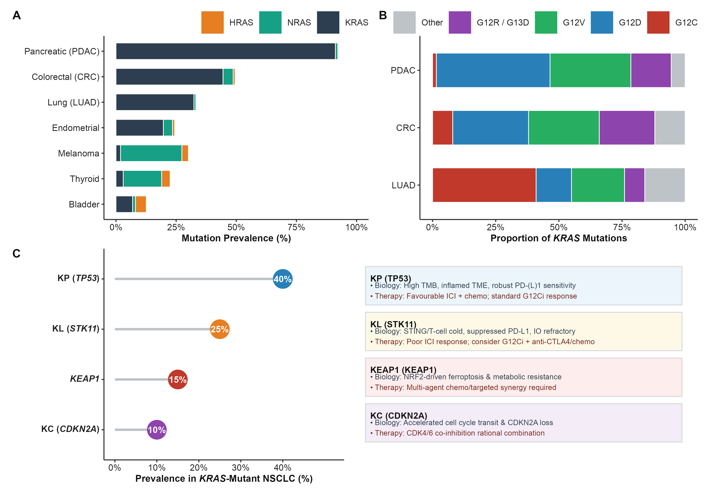
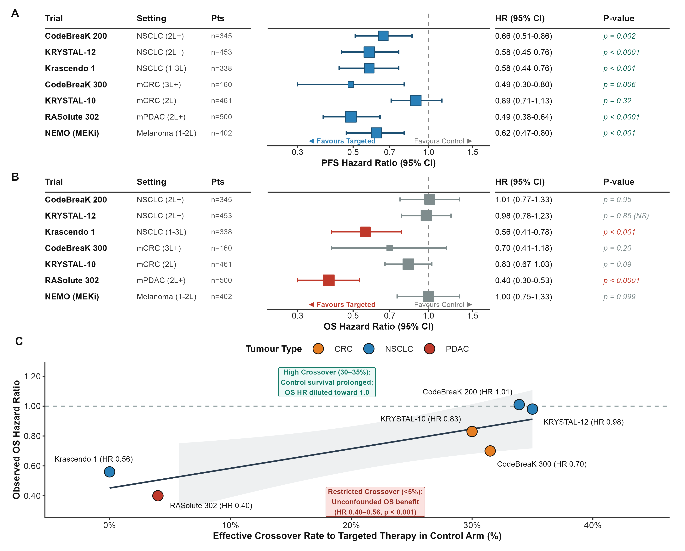
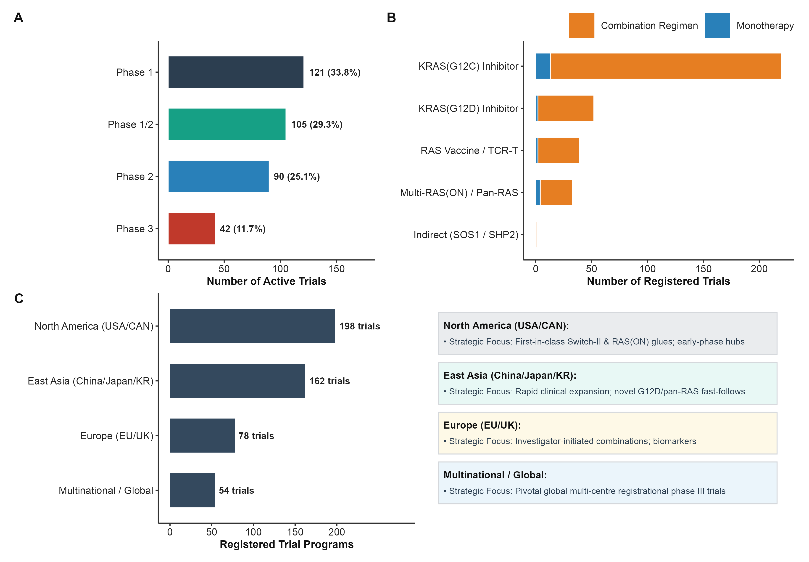
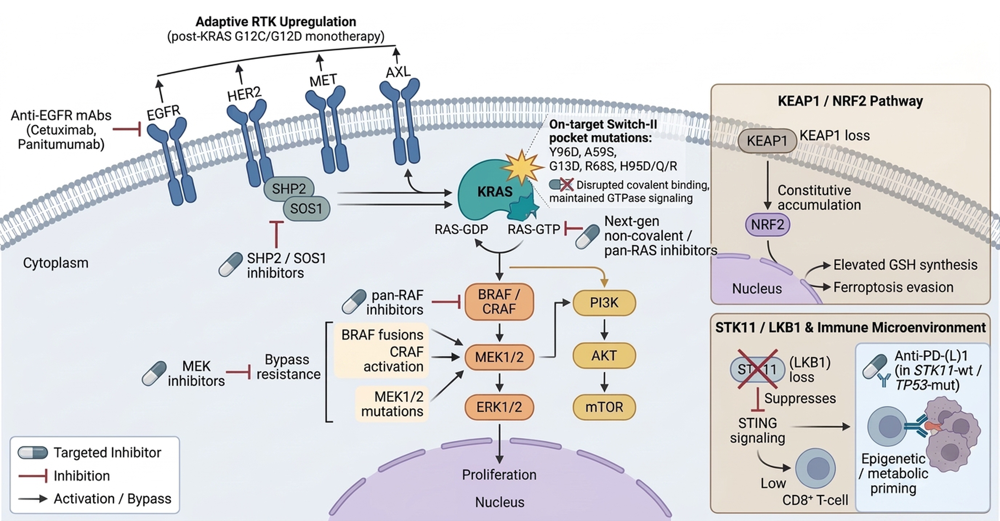
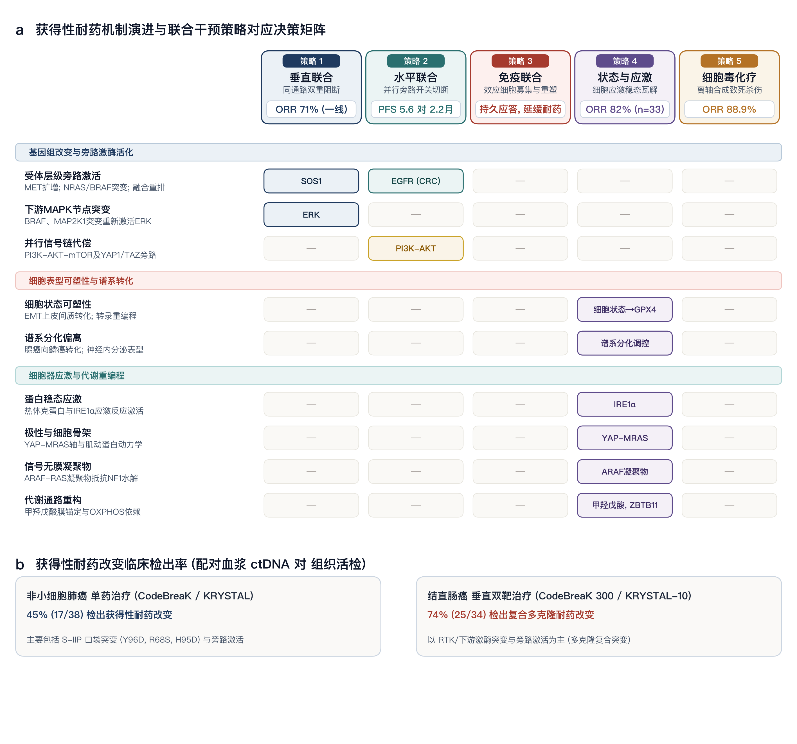

# RAS-Targeted Therapy in Solid Tumours: What the Randomised Trials Establish and What They Leave Open

[](https://creativecommons.org/licenses/by/4.0/)
[](https://opensource.org/licenses/MIT)
[-003366.svg)](https://www.esmoopen.com/)
[](https://www.python.org/downloads/)
[](https://www.r-project.org/)
[](#)

> **Official Open-Science & Reproducibility Repository**  
> Supporting the Review Manuscript submitted to ***ESMO Open*** (Elsevier / ESMO).  
> **Authors:** Nianfei Wang, MD, PhD; Chiyu Sheng, MD; Jian Qi, PhD; Shumin Shen, PhD; Shanghu Wang, MD, PhD*.  
> **Repository Language:** [English (Default)](./README.md) | [中文说明文档](./README_CN.md)

---

## 📌 Executive Summary & Key Clinical Findings

Once considered chemically undruggable, oncogenic **RAS** proteins are now direct pharmacological targets across multiple solid tumor indications. However, emerging pivotal phase III randomised controlled trials (RCTs) present unexpected clinical and statistical paradoxes:

1. **The PFS vs. OS Discordance Paradox in Lung Cancer:** Second-line *KRAS* G12C monotherapies (CodeBreaK 200, KRYSTAL-12) achieve robust PFS improvements (HR 0.58–0.66) but no statistically significant overall survival benefit (OS HR 0.98–1.01). Quantitative meta-regression confirms this is confounded by 30%–35% post-progression crossover to targeted salvage therapy, diluting the observed OS hazard ratio toward unity.
2. **Chemo-Free Regimens in Colorectal Cancer:** In the confirmatory phase III KRYSTAL-10 trial, adagrasib plus cetuximab failed to demonstrate superiority over standard chemotherapy doublet plus bevacizumab in second-line mCRC (BICR PFS HR 0.89, OS HR 0.94), leading to the formal withdrawal of FDA accelerated approval on September 1, 2026.
3. **Multi-RAS Paradigm Shift in Pancreatic Cancer:** In metastatic PDAC, the phase III RASolute 302 trial demonstrated that daraxonrasib (RMC-6236, a first-in-class multi-RAS(ON) tri-complex inhibitor) doubled overall survival (13.2 vs 6.7 months; OS HR 0.40, p < 0.0001), representing the first regular FDA approval for a pan-RAS modulator.
4. **Preemptive Molecular Windows via Liquid Biopsy:** ctDNA clearance at Cycle 2 Day 1 strongly predicts durable clinical response (ORR ~80% vs <10%, HR < 0.35), while longitudinal monitoring captures secondary resistance alterations 2 to 4 months prior to RECIST radiographic progression.

> [!IMPORTANT]
> **Data & Literature Retrieval Freeze Cut-off Date:** **18 November 2026**  
> All clinical trials (ClinicalTrials.gov 1,182 oncology trials, 7 pivotal Phase III RCTs), regulatory approvals (FDA, EMA, NMPA, PMDA), and resistance literature cohorts are rigorously frozen through 18 November 2026.

---

## 🖼️ Visual Gallery & Manuscript Display Items

All figures and tables in this repository are strictly structured to match the official submitted manuscript:

| Display Item | Title & Description | Directory | Data Cut-off | Primary Script | High-Res Artwork |
|:---|:---|:---|:---|:---|:---|
| **Figure 1** | **Biophysical nucleotide cycling and structural paradigms of direct pharmacological RAS inhibition**<br>*(Cα displacement profiles, Switch-I/II dynamics, 3D Switch-II pocket ray-traced surface)* | [`01_Figure1_Structural_Mechanisms/`](./01_Figure1_Structural_Mechanisms/) | PDB Deposition | `run_figure1.py` | [500 DPI TIFF](./01_Figure1_Structural_Mechanisms/figures/Fig1.tif) · [Vector PDF](./01_Figure1_Structural_Mechanisms/figures/Fig1.pdf) · [PNG](./01_Figure1_Structural_Mechanisms/figures/Fig1.png) |
| **Figure 2** | **Pan-cancer genomic landscape of RAS alterations and co-mutational stratification**<br>*(Prevalence across 7 cancers, G>T transversion vs deamination alleles, KP/KL/KEAP1/KC subgroups)* | [`02_Figure2_PanCancer_Landscape/`](./02_Figure2_PanCancer_Landscape/) | 2026-11-18 | `run_figure2.R` | [500 DPI TIFF](./02_Figure2_PanCancer_Landscape/figures/Fig2.tif) · [Vector PDF](./02_Figure2_PanCancer_Landscape/figures/Fig2.pdf) · [EPS](./02_Figure2_PanCancer_Landscape/figures/Fig2.eps) |
| **Table 1** | **Methodological architecture and clinical efficacy endpoints across 7 pivotal phase III RCTs**<br>*(CodeBreaK 200, KRYSTAL-12, Krascendo 1, CodeBreaK 300, KRYSTAL-10, RASolute 302, NEMO)* | [`03_Table1_Pivotal_Phase3_RCTs/`](./03_Table1_Pivotal_Phase3_RCTs/) | 2026-11-18 | `build_table1.py` | [Markdown Table](./03_Table1_Pivotal_Phase3_RCTs/data/table1_pivotal_phase3_trials.md) · [CSV](./03_Table1_Pivotal_Phase3_RCTs/data/table1_pivotal_phase3_trials.csv) |
| **Figure 3** | **Efficacy synthesis and endpoint discordance across pivotal phase III randomised controlled trials**<br>*(PFS & OS Forest plots, linear crossover confounding meta-regression)* | [`04_Figure3_Phase3_Efficacy_Discordance/`](./04_Figure3_Phase3_Efficacy_Discordance/) | 2026-11-18 | `run_figure3_forest_regression.R` | [500 DPI TIFF](./04_Figure3_Phase3_Efficacy_Discordance/figures/Fig3.tif) · [Vector PDF](./04_Figure3_Phase3_Efficacy_Discordance/figures/Fig3.pdf) · [EPS](./04_Figure3_Phase3_Efficacy_Discordance/figures/Fig3.eps) |
| **Figure 4** | **Global landscape and geographic distribution of 1,182 RAS-related oncology clinical trials**<br>*(Phase funnel, G12C/G12D/pan-RAS modalities, mono vs combo, North America vs East Asia vs Europe)* | [`05_Figure4_Global_Trial_Landscape/`](./05_Figure4_Global_Trial_Landscape/) | 2026-11-18 | `run_figure4_trial_landscape.R` | [500 DPI TIFF](./05_Figure4_Global_Trial_Landscape/figures/Fig4.tif) · [Vector PDF](./05_Figure4_Global_Trial_Landscape/figures/Fig4.pdf) · [EPS](./05_Figure4_Global_Trial_Landscape/figures/Fig4.eps) |
| **Figure 5** | **Comprehensive molecular networks of acquired resistance and multimodal combination strategies**<br>*(Switch-II mutations, RTK feedback, MAPK bypass, lineage plasticity, ctDNA lead time)* | [`06_Figure5_Resistance_Networks/`](./06_Figure5_Resistance_Networks/) | 2026-11-18 | `run_figure5.py` | [500 DPI TIFF](./06_Figure5_Resistance_Networks/figures/Fig5.tif) · [Vector PDF](./06_Figure5_Resistance_Networks/figures/Fig5.pdf) · [PNG](./06_Figure5_Resistance_Networks/figures/Fig5.png) |
| **Figure S1** | **Supplementary Figure S1: 9x5 Strategy Decision Matrix & Clinical Alteration Detection Rates**<br>*(Mechanisms mapped against Vertical, Horizontal, Immunotherapy, State/Stress, and ctDNA)* | [`07_Supplementary_Material/`](./07_Supplementary_Material/) | 2026-11-18 | `run_figureS1_resistance_matrix.py` | [500 DPI TIFF](./07_Supplementary_Material/figures/FigS1.tif) · [Vector PDF](./07_Supplementary_Material/figures/FigS1.pdf) · [PNG](./07_Supplementary_Material/figures/FigS1.png) |
| **Tables S1–S3** | **Supplementary Tables S1–S3: Inhibitor landscape, Regulatory approvals, Resistance matrix** | [`07_Supplementary_Material/`](./07_Supplementary_Material/) | 2026-11-18 | `build_supplementary_tables.py` | [Supplementary Appendix PDF](./07_Supplementary_Material/RAS_Targeted_Therapy_Review_Supplementary_Appendix.pdf) · [Word](./07_Supplementary_Material/RAS_Targeted_Therapy_Review_Supplementary_Appendix.docx) |

---

### Figure Previews (Click to inspect full resolution):

<div align="center">
  
  <p><em><b>Figure 1:</b> Biophysical nucleotide cycling and structural paradigms of direct pharmacological RAS inhibition.</em></p>
  <br/>
  
  <p><em><b>Figure 2:</b> Pan-cancer genomic landscape of RAS alterations and co-mutational stratification.</em></p>
  <br/>
  
  <p><em><b>Figure 3:</b> Efficacy synthesis, forest plots, and crossover meta-regression across pivotal phase III RCTs.</em></p>
  <br/>
  
  <p><em><b>Figure 4:</b> Global landscape and geographic distribution of 1,182 RAS-related oncology clinical trials.</em></p>
  <br/>
  
  <p><em><b>Figure 5:</b> Comprehensive molecular networks of acquired resistance and multimodal combination strategies.</em></p>
  <br/>
  
  <p><em><b>Supplementary Figure S1:</b> Strategy decision matrix mapping 9 acquired resistance mechanisms against 5 clinical combination logics.</em></p>
</div>

---

## ⚡ Quick Start: One-Click Full Reproduction

You can reproduce all publication figures and tables with a single terminal command:

### 1. Clone Repository & Setup Environment
```bash
git clone https://github.com/wangnianfei/RAS-Targeted-Therapy-Reproducibility.git
cd RAS-Targeted-Therapy-Reproducibility

# Install Python dependencies (or use uv)
pip install -r requirements.txt

# Install R dependencies (ggplot2, patchwork, dplyr, tidyr, scales, ggrepel, ggtext)
Rscript install_dependencies.R
```

### 2. Execute Full Automated Reproduction
```bash
bash reproduce_all.sh
```
This script sequentially executes all scripts in exact paper order:
- `[1/7] run_figure1.py` -> Computes Cα displacement & outputs Fig 1
- `[2/7] run_figure2.R` -> Generates Fig 2 (Pan-cancer & co-mutations)
- `[3/7] build_table1.py` -> Verifies 7 Phase III trials & exports Table 1
- `[4/7] run_figure3_forest_regression.R` -> Generates Fig 3 (Forest plots & meta-regression)
- `[5/7] run_figure4_trial_landscape.R` -> Generates Fig 4 (1,182 trials global atlas)
- `[6/7] run_figure5.py` -> Validates Fig 5 (500 DPI resistance networks)
- `[7/7] run_figureS1_resistance_matrix.py` & `build_supplementary_tables.py` -> Generates Fig S1 & Tables S1-S3

---

## 📂 Repository Structure

```text
RAS-Targeted-Therapy-Reproducibility/
├── 01_Figure1_Structural_Mechanisms/           # Fig 1: PDB coordinates, Cα RMSD script, 500 DPI TIFF & PDF
├── 02_Figure2_PanCancer_Landscape/             # Fig 2: MSK-IMPACT curated data, R/ggplot script, vector outputs
├── 03_Table1_Pivotal_Phase3_RCTs/              # Table 1: 7 Phase III RCTs clinical dataset & verification script
├── 04_Figure3_Phase3_Efficacy_Discordance/     # Fig 3: Forest plots & crossover meta-regression script
├── 05_Figure4_Global_Trial_Landscape/          # Fig 4: 1,182 ClinicalTrials.gov trials dataset & global atlas
├── 06_Figure5_Resistance_Networks/             # Fig 5: Acquired resistance networks & 500 DPI production assets
├── 07_Supplementary_Material/                  # Fig S1 & Tables S1-S3, 4-page Supplementary Appendix (PDF/docx)
├── manuscript/                                 # Full submitted manuscript files (English & Chinese, docx & md)
├── promotion/                                  # Social media threads (Twitter/X, LinkedIn), WeChat推文, Key Takeaways
├── METHODOLOGY.md                              # Rigorous clinical & computational methodology statement
├── reproduce_all.sh                            # One-click reproduction shell script
├── requirements.txt                            # Python dependencies
├── environment.yml                             # Conda environment definition
├── install_dependencies.R                      # R package installer
├── CITATION.cff                                # Citation metadata
├── LICENSE                                     # Dual MIT & CC-BY 4.0 license
├── README.md                                   # English documentation (this file)
└── README_CN.md                                # 中文详细复现与学术解读说明文档
```

---

## 📖 Citation & License

### License:
- **Scientific Figures, Artwork & Data:** Licensed under [Creative Commons Attribution 4.0 International (CC BY 4.0)](https://creativecommons.org/licenses/by/4.0/).
- **Source Code & Pipelines:** Licensed under the [MIT License](./LICENSE).

### Academic Citation:
```bibtex
@article{Wang2026RASTargetedTherapy,
  author    = {Wang, Nianfei and Sheng, Chiyu and Qi, Jian and Shen, Shumin and Wang, Shanghu},
  title     = {RAS-targeted therapy in solid tumours: what the randomised trials establish and what they leave open},
  journal   = {ESMO Open},
  year      = {2026},
  note      = {Data and reproduction code available at https://github.com/wangnianfei/RAS-Targeted-Therapy-Reproducibility}
}
```

- **Corresponding Author:** Shanghu Wang, MD, PhD (wangshanghu@mail.ustc.edu.cn)
- **First Author / Maintainer:** Nianfei Wang, MD, PhD (wangnianfei@ustc.edu / wangnianfei@gmail.com)
