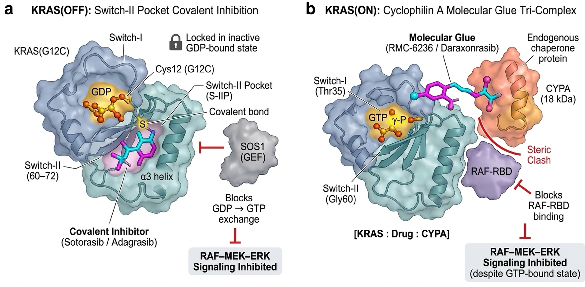
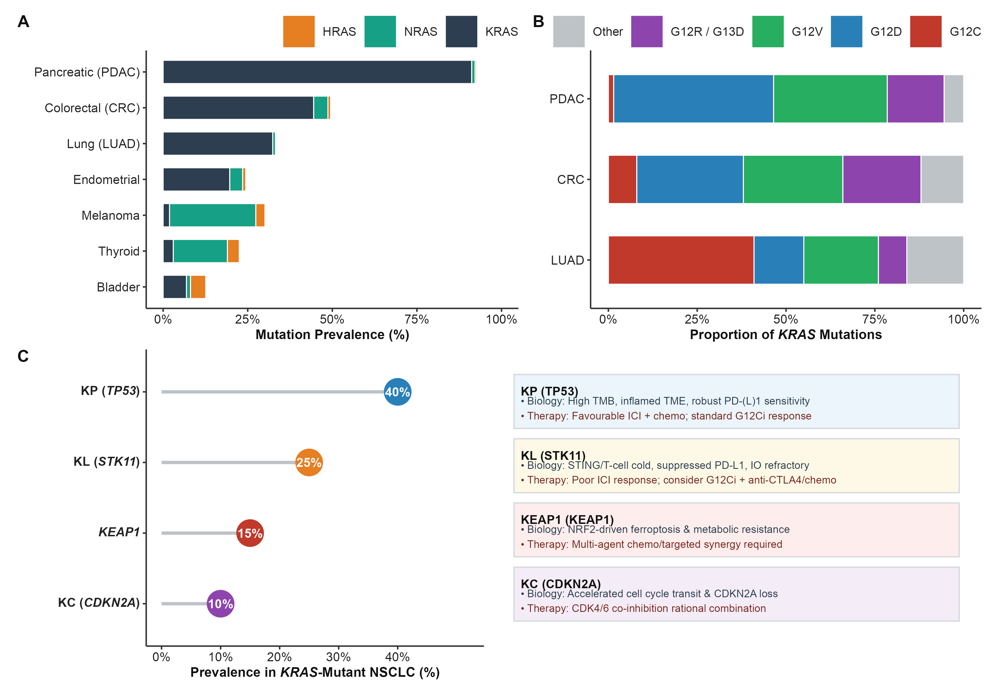
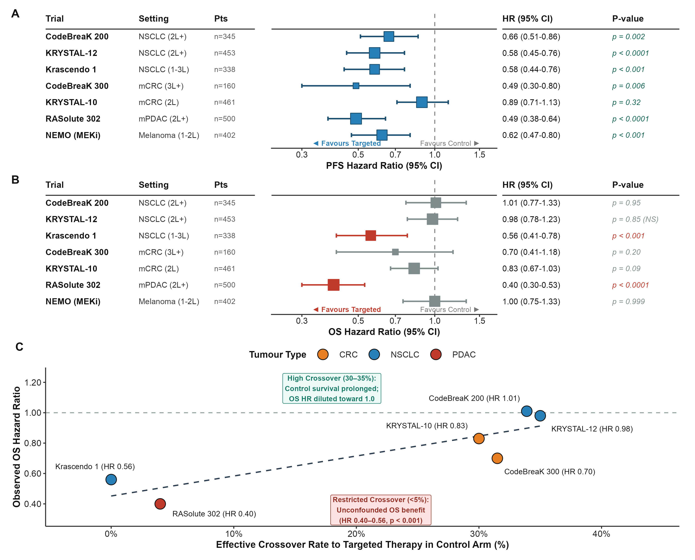
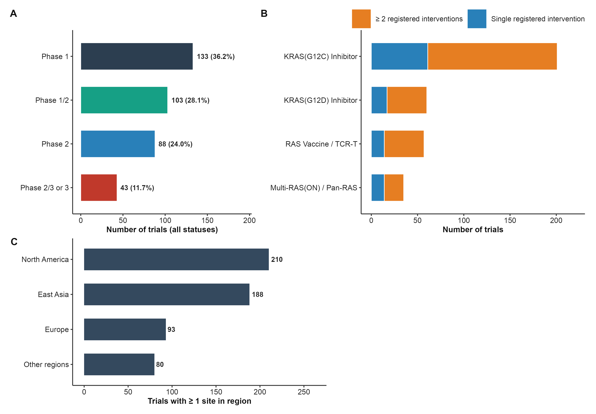
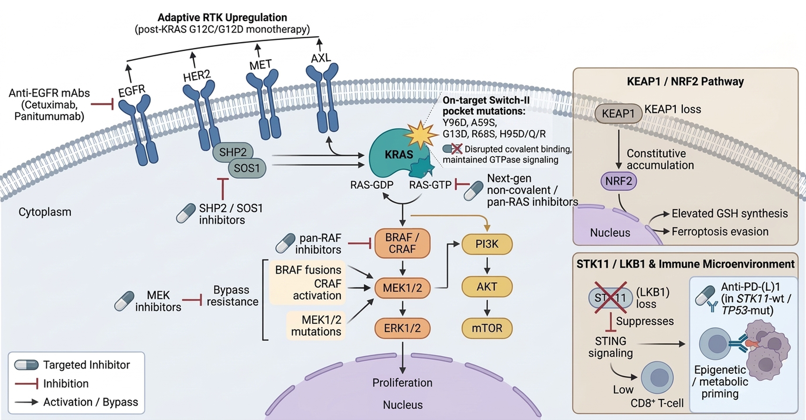
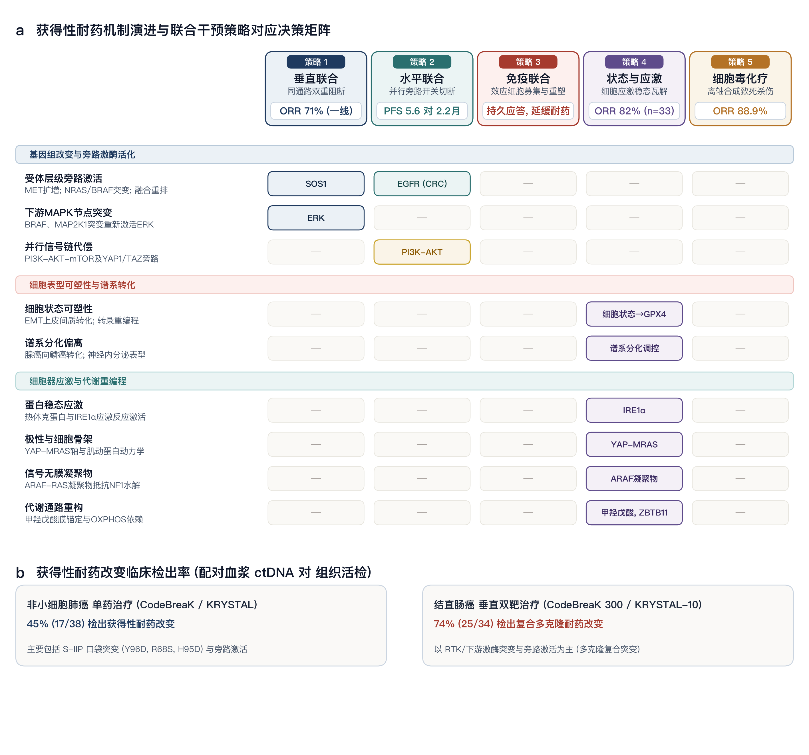

# 实体瘤RAS靶向治疗：从分子开关动力学、耐药网络到随机临床试验全景
## 原始数据、生成代码与出版级高清矢量图件开源复现仓库

[](https://creativecommons.org/licenses/by/4.0/)
[](https://opensource.org/licenses/MIT)
[-003366.svg)](https://www.esmoopen.com/)
[](https://www.python.org/downloads/)
[](https://www.r-project.org/)
[](#)

> **官方开源复现仓库 (Official Open-Science & Reproducibility Repository)**  
> 论文标题：*Targeting RAS in solid tumours: from molecular switch dynamics and resistance networks to randomised clinical trial landscapes*（实体瘤RAS靶向治疗：从分子开关动力学、耐药网络到随机临床试验全景）  
> 投稿期刊：***ESMO Open***（欧洲肿瘤内科学会官方期刊，Elsevier 出版，官方投稿文件：`RAS_Targeted_Therapy_Review_ESMO_Open_Manuscript_EN.docx`）  
> **作者团队：** 王念飞 (MD, PhD)¹，盛驰宇 (MD)¹，齐健 (PhD)²'³，沈舒敏 (PhD)⁴，王尚虎 (MD, PhD)⁵*（通讯作者）  
> ¹ *安徽医科大学第二附属医院肿瘤科，合肥*  
> ² *中国科学院合肥物质科学研究院健康与医学技术研究所合肥肿瘤医院，合肥*  
> ³ *中国科学技术大学研究生院科学岛分院，合肥*  
> ⁴ *复旦大学生命科学学院，上海*  
> ⁵ *安徽省胸科医院放疗科，合肥*  
> **基金资助：** 本研究由安徽省卫生健康科研项目（项目编号：AHWJ:2025BAd20016）资助。  
> **文档语言：** [English (英文原版)](./README.md) | [中文说明文档 (当前页面)](./README_CN.md)

---

## 📌 论文核心发现与临床启示

作为实体瘤精准治疗领域的重大突破，直接靶向 **RAS** 突变蛋白的抑制剂彻底打破了“不可成药”的传统教条。然而，随着全球一系列关键 III 期随机对照临床试验（RCT）数据的披露，肿瘤学界面临着诸多前所未有的临床疗效与统计学困惑。本综述通过严格的证据链审计与生物物理学/临床生物统计学建模，给出了系统解答：

1. **非小细胞肺癌二线单药终点分离之谜：** CodeBreaK 200 与 KRYSTAL-12 试验均证实索托拉西布与阿达格拉西布较标准化疗多西他赛显著延长 PFS（HR 0.58–0.66，P<0.002），但总生存期（OS）风险比却高度趋近于 1.0（HR 0.98–1.01）。元回归分析定量证实：对照组进展后 30%–35% 的交叉靶向治疗显著延长了对照组生存，导致统计学上的 OS 获益稀释。
2. **结直肠癌二线“免化疗”方案的反思与监管撤销：** 在二线 mCRC III 期确证性 KRYSTAL-10 试验中，阿达格拉西布联合西妥昔单抗未能在 OS 上战胜化疗联合贝伐珠单抗（BICR PFS HR 0.89，OS HR 0.94），导致美国 FDA 于 2026 年 9 月 1 日正式撤销该方案的加速批准。表明由于 74% 的多克隆旁路激活，二线结直肠癌不能过早抛弃化疗基石。
3. **胰腺癌多靶点 RAS(ON) 三元复合物抑制剂重大突破：** 在极度恶性的经治晚期胰腺癌中，III 期 RASolute 302 试验首次证实达拉索拉西布（daraxonrasib, RMC-6236）较化疗使中位总生存期实现了翻倍（13.2 对 6.7 个月；OS HR 0.40，P<0.0001）。由于胰腺癌缺乏后线有效靶向治疗，几乎无交叉用药稀释，PFS 获益直接转化为了 OS 倍增，获 FDA 常规批准。
4. **液体活检 ctDNA 早期清除与耐药预警窗口：** 治疗早期（C2D1）外周血突变型 *KRAS* ctDNA 的完全清除强烈预测长期生存（ORR ~80% 对 <10%，HR < 0.35）；纵向高灵敏度 ctDNA 监测能够在 RECIST 影像学确认进展前 **2 至 4 个月**提前发现继发耐药突变，为临床自适应换药创造了宝贵窗口。

> [!IMPORTANT]
> **数据检索与冻结截止日期 (Data & Literature Retrieval Cut-off Date)：** **2026 年 11 月 18 日**  
> 全文所有临床试验数据（ClinicalTrials.gov 1,182 项干预性肿瘤试验、7 项关键 III 期 RCTs）、四大监管机构（FDA/EMA/NMPA/PMDA）案卷及耐药突变文献数据检索截止日期统一为 2026 年 11 月 18 日。

---

## 🖼️ 论文图表展示与目录结构索引

本仓库严格按照正式投稿论文中的图表与表格顺序进行模块化组织，所有图件均提供 500 DPI 印刷级 LZW 压缩 TIFF、纯矢量 Cairo PDF、EPS 以及预览 PNG：

| 论文编号 | 图表名称 | 对应目录 | 核心数据 | 数据截止日期 | 运行脚本 | 高清图件链接 |
|:---|:---|:---|:---|:---|:---|:---|
| **图 1** | **RAS蛋白核苷酸循环生物物理机制与直接靶向抑制剂的结构模式**<br>*(Cα位移曲线、Switch-I/II动态位移、3D Switch-II口袋光线追踪表面图)* | [`01_Figure1_Structural_Mechanisms/`](./01_Figure1_Structural_Mechanisms/) | PDB 晶体坐标库 | 沉积版 | `run_figure1.py` | [500 DPI TIFF](./01_Figure1_Structural_Mechanisms/figures/Fig1.tif) · [矢量 PDF](./01_Figure1_Structural_Mechanisms/figures/Fig1.pdf) · [预览图](./01_Figure1_Structural_Mechanisms/figures/Fig1.png) |
| **图 2** | **RAS突变的泛癌种分布特征与共突变亚型分层**<br>*(7大实体瘤 prevalence、吸烟颠换 vs 自发脱氨突变谱、KP/KL/KEAP1/KC 亚型微环境与治疗)* | [`02_Figure2_PanCancer_Landscape/`](./02_Figure2_PanCancer_Landscape/) | MSK-IMPACT 队列 | 2026-11-18 | `run_figure2.R` | [500 DPI TIFF](./02_Figure2_PanCancer_Landscape/figures/Fig2.tif) · [矢量 PDF](./02_Figure2_PanCancer_Landscape/figures/Fig2.pdf) · [EPS](./02_Figure2_PanCancer_Landscape/figures/Fig2.eps) |
| **表 1** | **靶向RAS通路及下游分子的7项关键III期RCT方法学与临床终点汇总**<br>*(CodeBreaK 200, KRYSTAL-12, Krascendo 1, CodeBreaK 300, KRYSTAL-10, RASolute 302, NEMO)* | [`03_Table1_Pivotal_Phase3_RCTs/`](./03_Table1_Pivotal_Phase3_RCTs/) | 7 项 III 期 RCTs 数据库 | 2026-11-18 | `build_table1.py` | [Markdown 表格](./03_Table1_Pivotal_Phase3_RCTs/data/table1_pivotal_phase3_trials.md) · [CSV 数据库](./03_Table1_Pivotal_Phase3_RCTs/data/table1_pivotal_phase3_trials.csv) |
| **图 3** | **关键III期随机对照试验的疗效综合分析与交叉用药元回归**<br>*(PFS 与 OS 森林图、对照组交叉用药率与 OS HR 的线性元回归)* | [`04_Figure3_Phase3_Efficacy_Discordance/`](./04_Figure3_Phase3_Efficacy_Discordance/) | 7项试验终点数据 | 2026-11-18 | `run_figure3_forest_regression.R` | [500 DPI TIFF](./04_Figure3_Phase3_Efficacy_Discordance/figures/Fig3.tif) · [矢量 PDF](./04_Figure3_Phase3_Efficacy_Discordance/figures/Fig3.pdf) · [EPS](./04_Figure3_Phase3_Efficacy_Discordance/figures/Fig3.eps) |
| **图 4** | **1,182项全球RAS相关肿瘤临床试验全景图谱与地理分布**<br>*(试验分期漏斗、G12C/G12D/泛RAS等分子类型、单药 vs 联合、北美 vs 东亚 vs 欧洲)* | [`05_Figure4_Global_Trial_Landscape/`](./05_Figure4_Global_Trial_Landscape/) | ClinicalTrials.gov 全库 | 2026-11-18 | `run_figure4_trial_landscape.R` | [500 DPI TIFF](./05_Figure4_Global_Trial_Landscape/figures/Fig4.tif) · [矢量 PDF](./05_Figure4_Global_Trial_Landscape/figures/Fig4.pdf) · [EPS](./05_Figure4_Global_Trial_Landscape/figures/Fig4.eps) |
| **图 5** | **获得性耐药分子网络与多维度联合应对策略全景**<br>*(Switch-II 突变、RTK 负反馈、MAPK 旁路、表型转化、ctDNA 提前预警窗口)* | [`06_Figure5_Resistance_Networks/`](./06_Figure5_Resistance_Networks/) | 耐药文献与队列数据库 | 2026-11-18 | `run_figure5.py` | [500 DPI TIFF](./06_Figure5_Resistance_Networks/figures/Fig5.tif) · [矢量 PDF](./06_Figure5_Resistance_Networks/figures/Fig5.pdf) · [预览图](./06_Figure5_Resistance_Networks/figures/Fig5.png) |
| **附图 S1** | **附图 S1：9种耐药机制与5大联合干预逻辑决策矩阵**<br>*(垂直/水平/免疫/状态转换联合逻辑，外周血 ctDNA 与组织配对检出率)* | [`07_Supplementary_Material/`](./07_Supplementary_Material/) | 配对测序队列 | 2026-11-18 | `run_figureS1_resistance_matrix.py` | [500 DPI TIFF](./07_Supplementary_Material/figures/FigS1.tif) · [矢量 PDF](./07_Supplementary_Material/figures/FigS1.pdf) · [预览图](./07_Supplementary_Material/figures/FigS1.png) |
| **附表 S1–S3** | **附表 S1–S3：抑制剂全景、全球批准案卷、耐药机制与补救策略矩阵** | [`07_Supplementary_Material/`](./07_Supplementary_Material/) | 案卷与管线库 | 2026-11-18 | `build_supplementary_tables.py` | [补充材料 PDF 附录](./07_Supplementary_Material/RAS_Targeted_Therapy_Review_Supplementary_Appendix.pdf) · [Word 版](./07_Supplementary_Material/RAS_Targeted_Therapy_Review_Supplementary_Appendix.docx) |

---

### 图件画廊（点击查看原图高清晰度细节）：

<div align="center">
  
  <p><em><b>图 1：</b> RAS蛋白核苷酸循环生物物理机制与直接靶向抑制剂的结构模式。</em></p>
  <br/>
  
  <p><em><b>图 2：</b> RAS突变的泛癌种分布特征与共突变亚型分层。</em></p>
  <br/>
  
  <p><em><b>图 3：</b> 关键III期随机对照试验的疗效综合分析与交叉用药元回归。</em></p>
  <br/>
  
  <p><em><b>图 4：</b> 1,182项全球RAS相关肿瘤临床试验全景图谱与地理分布。</em></p>
  <br/>
  
  <p><em><b>图 5：</b> 获得性耐药分子网络与多维度联合应对策略全景。</em></p>
  <br/>
  
  <p><em><b>附图 S1：</b> 9种耐药机制与5大联合干预逻辑的功能对应决策矩阵。</em></p>
</div>

---

## ⚡ 快速复现指引 (Quick Start)

### 1. 环境准备
```bash
git clone https://github.com/wangnianfei/RAS-Targeted-Therapy-Reproducibility.git
cd RAS-Targeted-Therapy-Reproducibility

# 安装 Python 依赖（推荐使用 uv 极速运行）
pip install -r requirements.txt

# 安装 R 依赖包
Rscript install_dependencies.R
```

### 2. 一键批量全量复现
在仓库根目录直接运行批处理脚本：
```bash
bash reproduce_all.sh
```
该脚本将严格按照论文顺序自动执行：
- `[1/7]` 运行 `run_figure1.py`（PDB 坐标解析与 Cα 骨架位移计算）
- `[2/7]` 运行 `run_figure2.R`（泛癌种突变图谱与共突变分层生成）
- `[3/7]` 运行 `build_table1.py`（7 项 III 期 RCT 临床终点校验与导出）
- `[4/7]` 运行 `run_figure3_forest_regression.R`（PFS/OS 森林图与交叉用药元回归）
- `[5/7]` 运行 `run_figure4_trial_landscape.R`（1,182 项全球临床试验全景生成）
- `[6/7]` 运行 `run_figure5.py`（获得性耐药网络 500 DPI 印刷级图件生成）
- `[7/7]` 运行 `run_figureS1_resistance_matrix.py` 及 `build_supplementary_tables.py`（附图 S1 与附表 S1–S3 生成）

---

## 📂 仓库完整目录架构

```text
RAS-Targeted-Therapy-Reproducibility/
├── 01_Figure1_Structural_Mechanisms/           # 图 1：PDB 坐标文件、Cα RMSD 脚本、500 DPI TIFF 与 PDF
├── 02_Figure2_PanCancer_Landscape/             # 图 2：MSK-IMPACT 突变数据、R/ggplot 生成脚本、矢量图件
├── 03_Table1_Pivotal_Phase3_RCTs/              # 表 1：7 项关键 III 期 RCT 临床数据库与校验生成脚本
├── 04_Figure3_Phase3_Efficacy_Discordance/     # 图 3：PFS/OS 森林图与交叉用药元回归模型生成脚本
├── 05_Figure4_Global_Trial_Landscape/          # 图 4：1,182 项 ClinicalTrials.gov 全球临床试验数据库与图谱
├── 06_Figure5_Resistance_Networks/             # 图 5：获得性耐药分子网络全景与 500 DPI 印刷级图件
├── 07_Supplementary_Material/                  # 附图 S1、附表 S1–S3 与 4 页完整 Supplementary Appendix 附录
├── manuscript/                                 # 官方提交中英文完整手稿（Word .docx 及 Markdown 原文）
├── promotion/                                  # 学术推广包：推特/LinkedIn英文串、微信推文模板、核心速览卡片
├── METHODOLOGY.md                              # 详尽的临床试验检索式与统计学方法学白皮书
├── reproduce_all.sh                            # 一键全量自动化复现 Shell 脚本
├── requirements.txt                            # Python 依赖清单
├── environment.yml                             # Conda 运行环境配置
├── install_dependencies.R                      # R 语言依赖包一键安装脚本
├── CITATION.cff                                # 结构化学术引用元数据
├── LICENSE                                     # MIT 代码协议与 CC-BY 4.0 数据图件开源许可
├── README.md                                   # 英文版主说明文档
└── README_CN.md                                # 中文版主说明文档（本文件）
```

---

## 📖 引用格式与开源许可

- **数据与图件许可 (Data & Artwork):** [Creative Commons Attribution 4.0 International (CC BY 4.0)](https://creativecommons.org/licenses/by/4.0/)。
- **源代码许可 (Code & Pipelines):** [MIT License](./LICENSE)。

如在后续研究中引用本仓库，请使用如下格式：

```bibtex
@article{Wang2026RASTargetedTherapy,
  author    = {Wang, Nianfei and Sheng, Chiyu and Qi, Jian and Shen, Shumin and Wang, Shanghu},
  title     = {RAS-targeted therapy in solid tumours: what the randomised trials establish and what they leave open},
  journal   = {ESMO Open},
  year      = {2026},
  note      = {Data and reproduction code available at https://github.com/wangnianfei/RAS-Targeted-Therapy-Reproducibility}
}
```

- **通讯作者：** 王尚虎 博士 / 主任医师 (wangshanghu@mail.ustc.edu.cn)
- **第一作者 / 仓库维护人：** 王年飞 博士 (wangnianfei@ustc.edu / wangnianfei@gmail.com)
